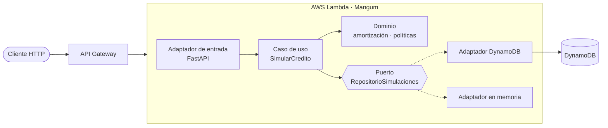

<div align="center">

# 💳 Simulador de Crédito API

**API serverless que simula créditos con el sistema de amortización francés y evalúa políticas de crédito. FastAPI + arquitectura hexagonal, desplegada en AWS Lambda con Terraform.**

[](https://github.com/JuanB12/simulador-credito-api/actions/workflows/ci.yml)


</div>

---

## 📌 ¿Qué hace?

Recibe una solicitud de crédito (monto, plazo, tasa efectiva anual y, opcionalmente, el ingreso mensual) y devuelve:

- 💰 La **cuota fija mensual**, el **total de intereses** y el **total a pagar**.
- 📅 El **plan de pagos completo**: interés, abono a capital y saldo de cada mes.
- ✅ Una **decisión de crédito** según las políticas: rango de monto y plazo, tasa máxima y **capacidad de pago** (la cuota no debe superar el 30% del ingreso). Si no se aprueba, explica por qué.

Los cálculos usan `Decimal` para no perder centavos, y la última cuota absorbe el redondeo para que el saldo termine exactamente en cero.

## 🏛️ Arquitectura hexagonal

El dominio no sabe nada de FastAPI ni de AWS: se puede probar y reutilizar sin infraestructura.



```
app/
├── domain/          # Entidades, amortización francesa y políticas de crédito (Python puro)
├── ports/           # Interfaces que el dominio necesita (repositorio)
├── application/     # Caso de uso: SimularCredito
├── adapters/
│   ├── api/         # FastAPI: rutas y esquemas Pydantic
│   └── persistencia/# DynamoDB (AWS) y memoria (local y pruebas)
└── handler.py       # Entrada de Lambda (Mangum)
infra/               # Terraform: Lambda, API Gateway, DynamoDB e IAM de mínimo privilegio
tests/               # 30 pruebas: dominio, API y DynamoDB simulado con moto
```

## 🔌 Endpoints

| Método | Ruta | Descripción |
|---|---|---|
| `POST` | `/simulaciones` | Simula un crédito y lo guarda |
| `GET` | `/simulaciones/{id}` | Consulta una simulación |
| `GET` | `/salud` | Estado del servicio |
| `GET` | `/docs` | Documentación interactiva (Swagger UI) |

**Ejemplo:**

```bash
curl -X POST http://localhost:8000/simulaciones \
  -H "Content-Type: application/json" \
  -d '{"monto": 10000000, "plazo_meses": 36, "tasa_efectiva_anual": 0.24, "ingreso_mensual": 3500000}'
```

```json
{
  "id": "3f9c1a...",
  "monto": "10000000",
  "plazo_meses": 36,
  "tasa_efectiva_anual": "0.24",
  "tasa_mensual": "0.01808758",
  "cuota_mensual": "380380.61",
  "total_intereses": "3693701.88",
  "total_pagar": "13693701.88",
  "decision": { "aprobada": true, "motivos": [] },
  "plan": [
    { "numero": 1, "cuota": "380380.61", "interes": "180875.82", "abono_capital": "199504.79", "saldo": "9800495.21" },
    { "numero": 2, "cuota": "380380.61", "interes": "177267.27", "abono_capital": "203113.34", "saldo": "9597381.87" }
  ]
}
```

## 🚀 Ejecutar en local

```bash
git clone https://github.com/JuanB12/simulador-credito-api.git
cd simulador-credito-api
python -m venv .venv
.venv\Scripts\activate            # Linux/Mac: source .venv/bin/activate
pip install -r requirements-dev.txt

uvicorn app.adapters.api.main:app --reload
```

Abre [http://localhost:8000/docs](http://localhost:8000/docs). En local se usa el repositorio en memoria; no necesitas AWS.

## 🧪 Pruebas y calidad

```bash
pytest --cov          # 30 pruebas, ~97% de cobertura
ruff check . && ruff format --check .
```

El [CI](.github/workflows/ci.yml) corre en cada push: lint, pruebas con un mínimo de 90% de cobertura y `terraform validate`.

## ☁️ Desplegar en AWS

Requiere una cuenta de AWS con credenciales configuradas y Terraform ≥ 1.6.

```bash
./scripts/empaquetar.sh        # genera build/lambda.zip (Python 3.12, arm64)
cd infra
terraform init
terraform apply                # crea DynamoDB, IAM, Lambda y API Gateway
```

Terraform imprime la URL pública (`url_api`) y la de la documentación (`url_documentacion`). Para eliminar todo: `terraform destroy`.

> Con poco tráfico, Lambda, API Gateway y DynamoDB bajo demanda suelen quedar dentro de la capa gratuita de AWS.

---

<div align="center">

Hecho por **[Juan Barrios](https://github.com/JuanB12)** · Backend Developer 🐍

</div>
